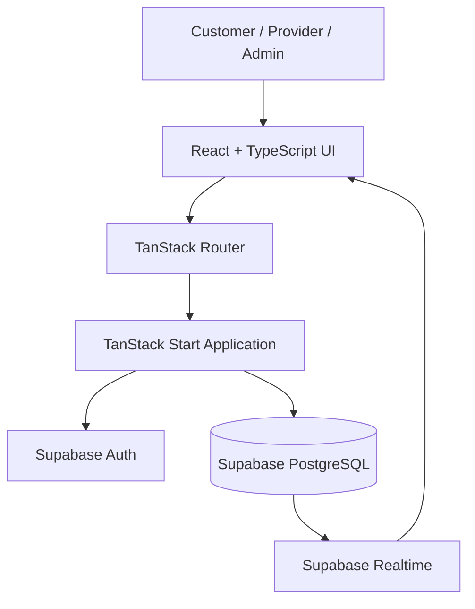
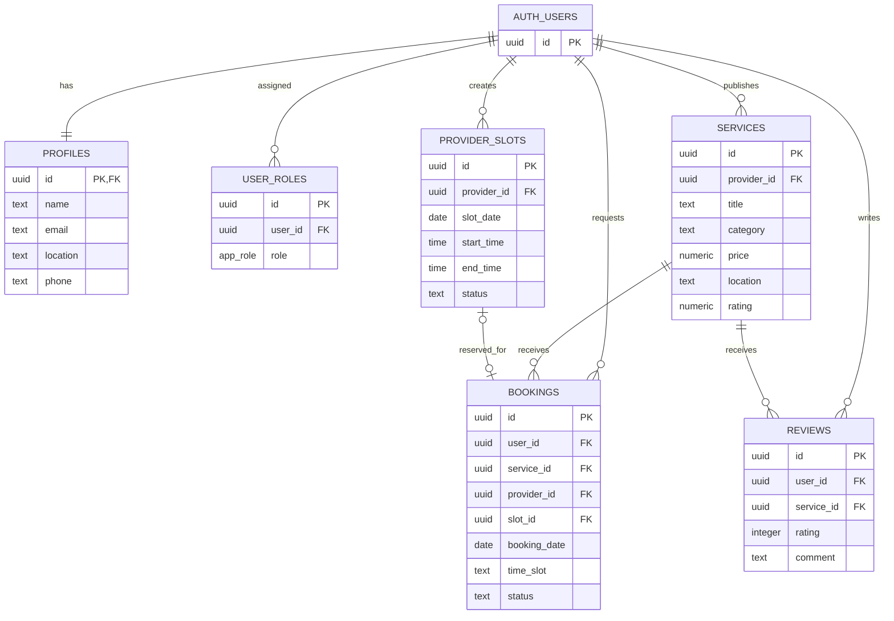
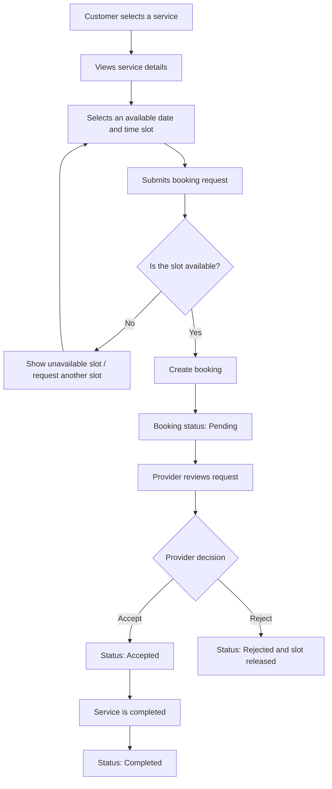

# Fixora — Trusted Local Services

**Fixora** is a web-based local services marketplace that helps customers discover service providers, view service details, schedule appointments, and manage bookings. Providers can publish services, manage availability, respond to booking requests, and view earnings information. An administrative interface provides an overview of platform activity.

> **Project type:** Full-stack web application  
> **Academic context:** B.Tech Computer Science and Engineering project  
> **Current implementation:** React + TypeScript + TanStack Start + Supabase

---

## Table of Contents

- [Overview](#overview)
- [Problem Statement](#problem-statement)
- [Proposed Solution](#proposed-solution)
- [User Roles](#user-roles)
- [Features](#features)
- [Technology Stack](#technology-stack)
- [System Architecture](#system-architecture)
- [Database Design](#database-design)
- [Booking Workflow](#booking-workflow)
- [Real-time Synchronization](#real-time-synchronization)
- [Security](#security)
- [Project Structure](#project-structure)
- [Getting Started](#getting-started)
- [Environment Variables](#environment-variables)
- [Database Setup](#database-setup)
- [Available Scripts](#available-scripts)
- [Deployment](#deployment)
- [Current Scope and Limitations](#current-scope-and-limitations)
- [Future Enhancements](#future-enhancements)
- [Contributing](#contributing)
- [License](#license)

---

## Overview

Finding a suitable local service provider can involve searching across multiple sources, contacting providers individually, checking availability, and coordinating appointments manually. Fixora brings these activities into one platform.

The application currently includes service discovery, role-based experiences for customers and providers, booking management, reviews, provider availability slots, and administrative views.

Fixora is designed as an extensible project. Features described under **Future Enhancements** are proposed improvements and should not be considered implemented functionality.

## Problem Statement

Customers often face difficulty finding relevant local service providers, comparing available options, and arranging appointments. Providers may also find it difficult to manage service listings, availability, and incoming booking requests through informal communication.

This can lead to:
- Time-consuming service discovery.
- Unclear pricing and service information.
- Manual appointment coordination.
- Scheduling conflicts and duplicate bookings.
- Limited visibility into booking history and provider earnings.

## Proposed Solution

Fixora provides a centralized web application where:
1. Customers can browse and search service listings.
2. Customers can review provider and service information before booking.
3. Customers can select an available date and time slot.
4. Providers can publish services and manage their availability.
5. Customers and providers can track booking status.
6. Administrators can view platform-level information.

## User Roles

| Role | Main responsibilities |
|---|---|
| Customer (`user`) | Browse services, view details, make bookings, track bookings, and submit reviews. |
| Service Provider (`provider`) | Manage service listings, create availability slots, review booking requests, and view booking and earnings information. |
| Administrator (`admin`) | Access administrative views and oversee platform records and activity. |

Access to protected application areas is controlled according to the signed-in user's role and database permissions.

## Features

### Customer features
- Account registration and sign-in through Supabase Authentication.
- Browse services by category.
- Search and filter service listings.
- View service descriptions, provider information, prices, ratings, and reviews.
- Select a date and available time slot to request a booking.
- View booking history and booking status.
- Submit a rating and review for a service.

### Provider features
- Access a provider dashboard.
- Create and manage service listings.
- Create and manage availability slots.
- View incoming booking requests.
- Accept or reject booking requests.
- View booking summaries and earnings breakdowns.

### Administrator features
- Access a role-protected administration dashboard.
- View platform-level user, service, and booking information presented by the application.

### Booking and business logic
- Booking statuses include `pending`, `accepted`, `rejected`, `completed`, and `cancelled`.
- A database-level unique index helps prevent duplicate active bookings for the same service, date, and time slot.
- Provider availability slots have `available`, `booked`, and `unavailable` states.
- The database booking trigger calculates a 10% platform commission and the corresponding provider earnings when a booking is created.
- Service ratings and review counts are recalculated when reviews are inserted, updated, or deleted.

### Location and tracking interface
The application includes a location/tracking interface that works with stored latitude and longitude values and displays a calculated distance/estimated time of arrival (ETA). The current interface uses an in-app visual representation; it should not be described as a full third-party maps or turn-by-turn navigation integration.

---

## Technology Stack

| Layer | Technology | Purpose |
|---|---|---|
| UI library | React 19 | Builds reusable user-interface components. |
| Programming language | TypeScript | Adds static typing to application code. |
| Full-stack framework | TanStack Start | Provides the application framework and server-side capabilities. |
| Routing | TanStack Router | Handles file-based application routes. |
| Build and development | Vite | Runs the development server and builds the application. |
| Styling | Tailwind CSS 4 | Provides utility-first responsive styling. |
| UI components | Radix UI and custom components | Accessible interface primitives and reusable components. |
| Icons | Lucide React | Interface icons. |
| Backend platform | Supabase | Provides managed backend services. |
| Database | PostgreSQL (Supabase) | Stores profiles, roles, services, bookings, reviews, and provider slots. |
| Authentication | Supabase Auth | Manages user authentication and sessions. |
| Real-time | Supabase Realtime | Delivers database change events to subscribed clients. |
| Data fetching/state | TanStack React Query | Manages asynchronous server data and caching. |
| Form validation | Zod and React Hook Form | Supports structured form handling and validation. |

**Architecture note:** The current repository uses Supabase and TanStack Start. It does not implement the originally proposed Express.js + MongoDB backend. Do not describe Express.js, MongoDB, or a separate REST API server as part of the current stack.

---

## System Architecture

The application follows a web-client and managed-backend architecture.



### Architecture overview
1. Users interact with the React-based interface.
2. TanStack Router manages navigation between application pages.
3. TanStack Start provides the application framework and server-side integration.
4. Supabase Auth handles sign-in and session management.
5. Supabase PostgreSQL stores application data.
6. Supabase Realtime publishes configured database changes to subscribed clients.
7. PostgreSQL Row Level Security (RLS) policies restrict data access.

---

## Database Design

Fixora uses **Supabase PostgreSQL**. The database migrations define the following application tables:

| Table | Purpose | Important fields |
|---|---|---|
| `profiles` | Stores profile information linked to an authenticated account. | `id`, `name`, `email`, `location`, `phone` |
| `user_roles` | Stores application roles for users. | `id`, `user_id`, `role` |
| `services` | Stores service listings and provider information. | `id`, `provider_id`, `title`, `category`, `price`, `location`, `rating` |
| `bookings` | Stores customer booking requests and their status. | `id`, `user_id`, `service_id`, `provider_id`, `booking_date`, `time_slot`, `status`, `slot_id` |
| `reviews` | Stores customer ratings and comments for services. | `id`, `user_id`, `service_id`, `rating`, `comment` |
| `provider_slots` | Stores provider availability slots. | `id`, `provider_id`, `slot_date`, `start_time`, `end_time`, `status`, `booking_id` |

### Entity relationships



`AUTH_USERS` represents Supabase's built-in `auth.users` table. It is managed by Supabase Authentication; it is not a custom table created in the application migration.

---

## Booking Workflow



The database includes a unique index for active bookings and a trigger that validates and updates provider-slot information during booking writes. This provides database-level protection in addition to the user-interface checks.

---

## Real-time Synchronization

Fixora uses **Supabase Realtime** to listen for changes to the `bookings` and `provider_slots` tables.

Typical flow:
1. A customer or provider opens a relevant dashboard.
2. The application subscribes to configured database changes.
3. A booking or availability record is inserted or updated.
4. Supabase Realtime sends the change event to subscribed clients.
5. The application can update the displayed information without requiring a manual page refresh.

Realtime publication is enabled for the `bookings` and `provider_slots` tables in the database migrations.

> Real-time synchronization is different from push notifications. The current implementation should be described as in-app database updates, not as guaranteed background/mobile push notifications.

---

## Security

The repository includes the following security mechanisms:

- **Supabase Auth:** Handles account authentication.
- **Role-based access:** Application roles include `user`, `provider`, and `admin`.
- **Protected routes:** Role-aware route protection is used for restricted areas.
- **Row Level Security:** PostgreSQL RLS policies restrict access to records.
- **Database constraints:** Checks, unique constraints, and foreign keys help maintain data integrity.
- **Server-only service role key:** The Supabase service role key is configured for server-side use and must never be exposed in browser code.

Never commit real environment files, passwords, API secrets, or Supabase service-role keys to the repository.

---

## Project Structure

A simplified view of the repository:

```text
Fixora/
├── public/                      # Static public assets
├── src/
│   ├── components/              # Shared UI and feature components
│   │   ├── ui/                  # Reusable UI primitives
│   │   ├── live-tracking.tsx
│   │   ├── service-card.tsx
│   │   ├── slot-picker.tsx
│   │   └── require-role.tsx
│   ├── hooks/                   # Reusable React hooks
│   ├── integrations/
│   │   └── supabase/            # Supabase clients, auth middleware and types
│   ├── lib/                     # Shared application logic and utilities
│   ├── routes/                  # File-based application routes
│   │   ├── admin.tsx
│   │   ├── auth.tsx
│   │   ├── book.$serviceId.tsx
│   │   ├── dashboard.tsx
│   │   ├── provider.tsx
│   │   ├── services.index.tsx
│   │   └── services.$id.tsx
│   ├── router.tsx
│   ├── routeTree.gen.ts
│   ├── server.ts
│   └── styles.css
├── supabase/
│   ├── config.toml
│   └── migrations/              # SQL schema, policies, triggers and indexes
├── .env.example
├── package.json
└── README.md
```

---

## Getting Started

### Prerequisites

Install:
- Node.js (use a version compatible with the installed Vite/TanStack dependencies).
- npm.
- A Supabase project.

### 1. Clone the repository

```bash
git clone https://github.com/SubhasmitaKar/Fixora.git
cd Fixora
```

If your GitHub repository uses a different owner or URL, replace the clone URL accordingly.

### 2. Install dependencies

```bash
npm install
```

### 3. Configure environment variables

Copy the example environment file:

```bash
cp .env.example .env
```

On Windows PowerShell, use:

```powershell
Copy-Item .env.example .env
```

Add the credentials from your Supabase project. See [Environment Variables](#environment-variables).

### 4. Configure the Supabase database

Apply the SQL migrations in the `supabase/migrations/` directory to your Supabase project in chronological order. You can use the Supabase CLI or the Supabase SQL Editor.

### 5. Start the development server

```bash
npm run dev
```

Open the local URL printed by Vite in your terminal.

---

## Environment Variables

The repository's `.env.example` defines these variables:

| Variable | Purpose | Exposure |
|---|---|---|
| `SUPABASE_PROJECT_ID` | Supabase project reference for server-side code. | Server environment |
| `SUPABASE_URL` | Supabase project URL for server-side code. | Server environment |
| `SUPABASE_PUBLISHABLE_KEY` | Supabase publishable key for server-side Supabase access. | Server environment |
| `VITE_SUPABASE_PROJECT_ID` | Supabase project reference used by the Vite client bundle. | Public/client |
| `VITE_SUPABASE_URL` | Supabase URL used by the Vite client bundle. | Public/client |
| `VITE_SUPABASE_PUBLISHABLE_KEY` | Supabase publishable key used by the browser client. | Public/client |
| `SUPABASE_SERVICE_ROLE_KEY` | Privileged server-side Supabase key for trusted server operations. | **Server only — secret** |

Use the values from your own Supabase project. Do not copy real credentials into this README.

**Important security rule:** Never add a `VITE_` prefix to `SUPABASE_SERVICE_ROLE_KEY`. Variables prefixed with `VITE_` may be exposed to browser code.

---

## Database Setup

The SQL migrations are located in:

```text
supabase/migrations/
```

They create the application schema, role definitions, row-level security policies, database functions, triggers, indexes, provider availability slots, and Realtime publication settings.

Apply all migrations to the Supabase project connected to the application. Confirm that the required tables and policies exist before testing the application.
The provider profile and booking contact fields in the latest migration must be applied before deploying this version; the provider dashboard reads the saved schedule and booking contact snapshots from those columns.

The first migration also inserts sample service listings for demonstration. These are sample records, not proof of real provider verification or real completed transactions.

---

## Available Scripts

| Command | Description |
|---|---|
| `npm run dev` | Starts the local development server. |
| `npm run build` | Creates a production build. |
| `npm run build:dev` | Creates a development-mode build. |
| `npm run preview` | Previews the built application locally. |
| `npm run lint` | Runs ESLint checks. |
| `npm run format` | Formats files with Prettier. |

---

## Deployment

The application is built with **TanStack Start**, so deployment must use a hosting environment compatible with its production server output/runtime. It should not automatically be treated as a static-only React/Vite website.

The repository is configured for Netlify using the official TanStack Start Vite adapter. Netlify builds the app with `npm run build` and publishes `dist/client`; the adapter packages the server-rendered routes as a Netlify function.

To deploy from Git:

1. Import the GitHub repository into Netlify and use the repository root as the base directory.
2. Set the install command to `npm ci` and ensure the build command is `npm run build`. The publish directory is `dist/client`.
3. Configure `SUPABASE_PROJECT_ID`, `SUPABASE_URL`, `SUPABASE_PUBLISHABLE_KEY`, `VITE_SUPABASE_PROJECT_ID`, `VITE_SUPABASE_URL`, and `VITE_SUPABASE_PUBLISHABLE_KEY` in the Netlify environment settings.
4. Keep `SUPABASE_SERVICE_ROLE_KEY` server-only; it is not required by the current application routes.
5. Add the deployed application URL and its auth paths (for example, `https://fixora-connect.netlify.app/**`) to Supabase Authentication's allowed redirect URLs. Password recovery returns to `/auth?mode=reset`.
6. Test sign-in, role-based access, database reads/writes, booking flows, and Realtime updates on the deployed site.

The Netlify site and its production environment variables still need to be configured in the Netlify dashboard.

---

## Current Scope and Limitations

This section describes the scope visible in the current repository and database migrations. It should be updated as the application is tested and developed.

- The project uses Supabase services rather than a separately implemented Express.js and MongoDB backend.
- The current location/tracking interface is a visual in-app representation and does not provide full map navigation.
- Supabase Realtime supports in-app data synchronization; it is not the same as background push notifications.
- The repository does not contain an AI-agent workflow. Automated agent action states are therefore not part of the current implementation.
- A production payment gateway and actual commission collection should not be claimed unless separately integrated and tested.
- Provider verification, identity checks, dispute handling, and service guarantees require additional implementation and operational processes.
- A production deployment host and public application URL are still to be finalized.

---

## Future Enhancements

Potential improvements include:

- Integrate a maps provider for accurate maps, routes, and live location sharing.
- Add push notifications for booking confirmations, cancellations, and reminders.
- Integrate a secure payment gateway and transaction reconciliation.
- Build provider identity verification and customer safety workflows.
- Add advanced service recommendations based on location, ratings, and booking history.
- Introduce an AI chatbot for service discovery and customer support.
- Add multilingual support for regional languages.
- Improve analytics, reporting, and provider performance insights.
- Add automated testing, monitoring, backups, and production observability.
- Improve accessibility and conduct broader mobile-device testing.

These items are proposed future enhancements and are not represented as completed features.

---

## Contributing

Contributions and suggestions are welcome.

1. Fork the repository.
2. Create a feature branch.
3. Make and test your changes.
4. Run `npm run lint` and `npm run build`.
5. Submit a pull request describing your changes.

---

## License

No license has been specified yet. Unless a license is added to this repository, the project should be treated as all rights reserved by its author.

---

**Fixora — Discover local services. Book with confidence.**
